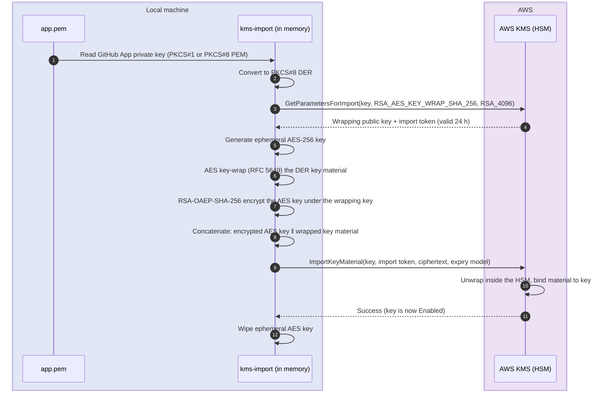

# kms-import

`kms-import` imports a GitHub App private key into AWS KMS as non-extractable
key material. Applications then sign GitHub App JWTs with `kms:Sign`, and the
private key exists nowhere outside KMS.

It ships as a CLI and a Go library. It imports into an existing KMS key and
does not create keys.

## How import works

KMS accepts key material only when it is encrypted ("wrapped") under a one-time
public key issued for the target key. The ciphertext must match the wrapping
algorithm's byte format exactly, and KMS rejects any mistake with a generic
error.

The diagram shows each step of one import. Everything on the local side happens
in memory.



The wrapping algorithm is fixed at `RSA_AES_KEY_WRAP_SHA_256` with an `RSA_4096`
wrapping key, the AWS recommendation for asymmetric key material. Only
`RSA_2048` key material is supported, which is the spec GitHub issues App keys
in.

The [manual import procedure][aws-import] performs the same steps with the AWS
CLI and `openssl`, at these costs:

- **Plaintext files.** The DER private key and the AES wrapping key are written
  to disk, creating more copies of the secret to destroy.
- **Opaque failures.** A wrong digest, padding variant, concatenation order, or
  import token all produce the same generic KMS error.
- **Toolchain dependence.** AES key wrap with padding needs OpenSSL 3.x. The
  LibreSSL shipped with macOS lacks it.

## Quick start

This guide imports a GitHub App private key into a new KMS key with default
settings. For production, follow [Protecting the GitHub private
key][chinmina-kms] on docs.chinmina.dev. It adds the key alias that rotation
depends on, a key policy that restricts signing to one service, and the order to
apply them in.

Before you start, you need:

- The GitHub App private key as a PEM file, referred to below as `<PEM_FILE>`.
- AWS credentials allowed to call `kms:CreateKey`, plus the
  [import permissions](#iam-permissions).

1. Install `kms-import`. [Installation](#installation) lists the other channels.

   ```sh
   mise use -g github:chinmina/kms-import
   ```

2. Create a KMS key, and save the printed ARN as `<KEY_ARN>`.

   ```sh
   aws kms create-key --origin EXTERNAL --key-spec RSA_2048 --key-usage SIGN_VERIFY \
     --query KeyMetadata.Arn --output text
   ```

   `EXTERNAL` origin allows import, `RSA_2048` matches GitHub App keys, and
   `SIGN_VERIFY` lets the key sign JWTs. The key starts in the `PendingImport`
   state.

3. Import the private key.

   ```sh
   kms-import --key-file <PEM_FILE> --key-arn <KEY_ARN>
   ```

   The output confirms the key is ready:

   ```text
   ✅ Key material imported successfully
    - Key ID: 1234abcd-12ab-34cd-56ef-1234567890ab
    - State:  Enabled

   The key is ready to use for signing.
   ```

4. Destroy every local copy of the PEM file. KMS cannot export the material, so
   a local copy is the only remaining way to leak the key.

> [!CAUTION]
> Do not import key material with infrastructure-as-code tooling. Terraform's
> `aws_kms_external_key` stores "all arguments including the key material … in
> the raw state as plain text" ([provider docs][tf-state]), and CloudFormation
> cannot import key material at all. Provision the key with IaC, leave
> `key_material_base64` unset, and import with `kms-import`.

## Installation

Pre-built binaries for Linux, macOS, and Windows (amd64/arm64) are published to
[GitHub Releases][releases]. Every artifact carries a build-provenance
attestation, described in [Verifying releases](#verifying-releases).

<details>
<summary><strong>mise (recommended)</strong></summary>

[mise](https://mise.jdx.dev/) installs directly from GitHub Releases via its
[GitHub backend](https://mise.jdx.dev/dev-tools/backends/github.html). It
verifies the artifact's checksum and, when the
[`github_attestations` setting](https://mise.jdx.dev/configuration/settings.html#github_attestations)
is enabled (currently the default), its build-provenance attestation:

```sh
mise use -g github:chinmina/kms-import
```

Or pin a version for a project in its `mise.toml`:

```toml
[tools]
"github:chinmina/kms-import" = "1.0.0"
```

</details>

<details>
<summary><strong>Install script</strong></summary>

Each release includes a self-contained installer script (generated with
[binstaller](https://github.com/binary-install/binstaller)) that detects your
platform and verifies the download against the release checksums embedded in
the script — no network fetch of the checksum file:

```sh
curl -fsSL https://github.com/chinmina/kms-import/releases/latest/download/install.sh | sh
```

It installs to `~/.local/bin` by default; pass `-b` for a different directory.
To pin a version, fetch the script from that release, so its embedded
checksums match:

```sh
curl -fsSL https://github.com/chinmina/kms-import/releases/download/v1.2.3/install.sh \
  | sh -s -- -b /usr/local/bin v1.2.3
```

The script has its own build-provenance attestation. A verified script holds
the genuine checksums for its release and enforces them on the binary, so
verifying the script covers the binary for that release (requires an
authenticated [GitHub CLI](https://cli.github.com/)):

```sh
curl -fsSL -O https://github.com/chinmina/kms-import/releases/latest/download/install.sh
gh attestation verify install.sh --repo chinmina/kms-import \
  --signer-workflow chinmina/.github/.github/workflows/goreleaser-release.yml
sh install.sh
```

</details>

<details>
<summary><strong>Homebrew (macOS)</strong></summary>

```sh
brew install chinmina/tap/kms-import
```

</details>

<details>
<summary><strong>Nix</strong></summary>

```sh
nix profile install github:chinmina/nixpkgs#kms-import
```

</details>

<details>
<summary><strong>Manual download</strong></summary>

Download the archive for your platform from the
[releases page](https://github.com/chinmina/kms-import/releases), verify its
provenance, and put the binary on your `PATH`:

```sh
OS=linux ARCH=amd64   # or darwin/windows, arm64
curl -fsSLO "https://github.com/chinmina/kms-import/releases/latest/download/kms-import_${OS}_${ARCH}.tar.gz"
gh attestation verify "kms-import_${OS}_${ARCH}.tar.gz" --repo chinmina/kms-import \
  --signer-workflow chinmina/.github/.github/workflows/goreleaser-release.yml
tar -xzf "kms-import_${OS}_${ARCH}.tar.gz" kms-import
install -m 0755 kms-import ~/.local/bin/
```

Windows archives are `.zip`. See [Verifying releases](#verifying-releases) for
what the attestation proves and for checksum-only verification.

</details>

<details>
<summary><strong>go install</strong></summary>

Build from source with Go 1.27.1+:

```sh
go install github.com/chinmina/kms-import/cmd/kms-import@latest
```

Source builds are not stamped with a release version, so `--version` reports
`dev`.

</details>

## CLI reference

`--key-file` and exactly one of `--key-id` or `--key-arn` are required. All
other flags are optional.

| Flag         | Type   | Default | Description |
|--------------|--------|---------|-------------|
| `--key-file` | string | —       | **Required.** Path to the PEM-encoded private key file. Accepts `BEGIN RSA PRIVATE KEY` (PKCS#1) and `BEGIN PRIVATE KEY` (PKCS#8); any other header is an error. |
| `--key-id`   | string | —       | Target KMS key ID. Mutually exclusive with `--key-arn`. |
| `--key-arn`  | string | —       | Target KMS key ARN. Mutually exclusive with `--key-id`. |
| `--expires`  | string | none (key material does not expire) | Expiry for the imported key material as an RFC 3339 timestamp (e.g. `2027-01-01T00:00:00Z`). A malformed or already-passed value is rejected before any AWS call is made. |
| `--profile`  | string | SDK default | AWS named profile to use. |
| `--region`   | string | SDK default | AWS region to use. |
| `--json`     | bool   | `false` | Emit the result as a single JSON object on stdout and suppress all other output. |
| `--help`, `-h`    | bool | `false` | Show help. |
| `--version`, `-v` | bool | `false` | Print the version. |

**Target selection.** The KMS import APIs accept a key ID or key ARN only, so
there is no `--alias` flag.

**Credentials.** Credentials and region resolve through the standard AWS SDK
chain (environment variables, shared config and credentials files, and IMDS).
`--profile` and `--region` override the corresponding defaults.

**Expiry and reimport.** Imported material does not expire by default
(`KEY_MATERIAL_DOES_NOT_EXPIRE`). `--expires` sets `KEY_MATERIAL_EXPIRES` with
the given `ValidTo`, and exists for compliance requirements. To revoke a
compromised key, delete it in the GitHub App settings, which takes effect
immediately. The same invocation performs both the initial import and a
reimport after material expires or is deleted. AWS requires a reimport to use
the same key material as the original.

**JSON output.** With `--json`, stdout carries only the result object:

```json
{"keyId":"1234abcd-12ab-34cd-56ef-1234567890ab","keyState":"Enabled"}
```

**Errors.** Any failure exits non-zero with the error on stderr and nothing on
stdout, including in `--json` mode. Input errors (an unreadable key file, an
undecodable PEM, an unsupported PEM header, or an invalid `--expires`) are
reported before any AWS call.

## IAM permissions

`kms-import` calls two actions on the target key: `kms:GetParametersForImport`
and `kms:ImportKeyMaterial`. KMS allows an action when the key policy allows
it, either by granting it directly or by delegating to IAM policies in the
account. Where to grant the import actions depends on the key policy:

- **Default key policy.** It delegates to IAM, so the caller IAM policy alone is
  enough.
- **Restrictive key policy.** Add the key policy statement as well as the caller
  IAM policy. The [key policy recommended by docs.chinmina.dev][chinmina-policy]
  already grants both actions to administrator roles through its
  `AdministratorsManage` statement.

Replace the account ID, region, key ID, and role ARN with your own values.

### Caller IAM policy

Attach this policy to the principal that runs `kms-import`. It is scoped to the
key ARN, and `GetParametersForImport` is constrained to the wrapping algorithm
and key spec `kms-import` uses. `ImportKeyMaterial` can also be constrained with
`kms:ExpirationModel` and `kms:ValidTo` to mandate an expiry policy.

```json
{
  "Version": "2012-10-17",
  "Statement": [
    {
      "Sid": "KMSGetWrappingParameters",
      "Effect": "Allow",
      "Action": "kms:GetParametersForImport",
      "Resource": "arn:aws:kms:us-east-1:111122223333:key/1234abcd-12ab-34cd-56ef-1234567890ab",
      "Condition": {
        "StringEquals": {
          "kms:WrappingAlgorithm": "RSA_AES_KEY_WRAP_SHA_256",
          "kms:WrappingKeySpec": "RSA_4096"
        }
      }
    },
    {
      "Sid": "KMSImportKeyMaterial",
      "Effect": "Allow",
      "Action": "kms:ImportKeyMaterial",
      "Resource": "arn:aws:kms:us-east-1:111122223333:key/1234abcd-12ab-34cd-56ef-1234567890ab"
    }
  ]
}
```

### Key policy statement

Add this statement to a restrictive key policy. It names the account as the
principal and matches the importing role with `aws:PrincipalArn`, so it keeps
working when the role is recreated ([rationale][chinmina-principal]). Within a
key policy, `"Resource": "*"` refers to the key the policy is attached to.

```json
{
  "Sid": "AllowKeyMaterialImport",
  "Effect": "Allow",
  "Principal": {
    "AWS": "arn:aws:iam::111122223333:root"
  },
  "Action": [
    "kms:GetParametersForImport",
    "kms:ImportKeyMaterial"
  ],
  "Resource": "*",
  "Condition": {
    "ArnLike": {
      "aws:PrincipalArn": "arn:aws:iam::111122223333:role/KeyImporter"
    }
  }
}
```

> [!NOTE]
> The `kms:RequestAlias` condition key has no effect on `GetParametersForImport`
> or `ImportKeyMaterial`, so scope import permissions by key ARN. Alias scoping
> belongs on the application's `kms:Sign` permission, as shown in
> [Configuring the Chinmina service][chinmina-sign].

## Key rotation

KMS cannot rotate imported asymmetric key material. Rotation creates a
replacement key, imports a new GitHub App private key into it, and repoints the
alias the application signs through.

`kms-import` performs the import step. Target the replacement key by ARN, since
the alias still points at the old key and the import APIs reject aliases.
Confirm the key reports `Enabled` before repointing the alias.

The [rotation process on docs.chinmina.dev][chinmina-rotate] covers the full
sequence. It includes generating the new key in GitHub, confirming the cutover
in CloudTrail, and deleting the old private key in GitHub, which is the step
that revokes it.

## Security rationale

A GitHub App private key grants every permission of the app to anyone who holds
it. Storing it in KMS rather than as a plaintext secret provides:

- **Non-extractability.** Imported material stays inside the KMS HSM boundary
  and no API reads it back. The application receives only signatures from
  `kms:Sign`.
- **Policy-based access.** Every use is authorised by the key policy and IAM,
  and access is revocable without touching the application.
- **Audit.** CloudTrail records every `GetParametersForImport`,
  `ImportKeyMaterial`, and `Sign` call against the key.
- **Alias-based rotation.** An application that signs through an alias picks up
  a replacement key with no restart or configuration change.

## Library usage

The import logic is a Go library that builds no SDK client and never calls
`os.Exit`. The caller injects a `KMSClient`, which the AWS SDK `*kms.Client`
satisfies. `cli.Command()` mounts the CLI as a subcommand of another urfave/cli
v3 application.

```go
import (
	"context"

	"github.com/aws/aws-sdk-go-v2/config"
	"github.com/aws/aws-sdk-go-v2/service/kms"
	"github.com/chinmina/kms-import/pkg/kmsimport"
)

cfg, _ := config.LoadDefaultConfig(ctx)
der, _ := kmsimport.KeyMaterialFromPEM(pemBytes) // PEM (PKCS#1 or PKCS#8) → PKCS#8 DER
res, err := kmsimport.Import(ctx,
	kmsimport.WithClient(kms.NewFromConfig(cfg)),
	kmsimport.WithKeyID("1234abcd-12ab-34cd-56ef-1234567890ab"),
	kmsimport.WithKeyMaterial(der),
)
```

## Verifying releases

Release artifacts (the binary archives and `install.sh`) are published to
[GitHub Releases][releases] and carry a [build provenance
attestation][gh-attestations] created with [Sigstore][sigstore] keyless
signing. Each artifact is bound, by digest, to the source commit and the
workflow run that built it. No long-lived signing key exists.

Verify a downloaded artifact with the [GitHub CLI][gh-cli] (2.49.0 or later):

```sh
gh attestation verify kms-import_linux_amd64.tar.gz --repo chinmina/kms-import \
  --signer-workflow chinmina/.github/.github/workflows/goreleaser-release.yml
```

`--repo` checks the source repository. `--signer-workflow` is required because
the artifacts are signed by the shared release workflow in `chinmina/.github`,
not by a workflow in this repository.

`checksums.txt` lists every archive. After downloading it alongside an archive,
check with `sha256sum --check --ignore-missing checksums.txt`, or
`shasum -a 256 --check --ignore-missing checksums.txt` on macOS.

Releases are immutable: once published, their assets cannot be changed and
their tag cannot be moved. GitHub records a release attestation of the tag,
commit, and every asset. Check a downloaded file against it with GitHub CLI
2.81.0 or later:

```sh
gh release verify-asset v1.2.3 kms-import_linux_amd64.tar.gz --repo chinmina/kms-import
```

[aws-import]: https://docs.aws.amazon.com/kms/latest/developerguide/importing-keys.html
[chinmina-kms]: https://docs.chinmina.dev/guides/kms/
[chinmina-policy]: https://docs.chinmina.dev/guides/kms/#restricting-access-to-the-key
[chinmina-principal]: https://docs.chinmina.dev/guides/kms/#why-the-principal-is-never-named-directly
[chinmina-sign]: https://docs.chinmina.dev/guides/kms/#configuring-the-chinmina-service
[chinmina-rotate]: https://docs.chinmina.dev/guides/kms/#rotating-the-key
[tf-state]: https://registry.terraform.io/providers/hashicorp/aws/latest/docs/resources/kms_external_key
[releases]: https://github.com/chinmina/kms-import/releases
[gh-attestations]: https://docs.github.com/en/actions/security-for-github-actions/using-artifact-attestations/using-artifact-attestations-to-establish-provenance-for-builds
[sigstore]: https://www.sigstore.dev/
[gh-cli]: https://cli.github.com/
